<h1 align="center">SPIDER-HEX</h1>

<p align="center">
  <strong>A six-legged robot, built from gears, servos, and a lot of iteration.</strong><br>
  Mechanical design · ESP32 MicroPython · Bluetooth control
</p>

<p align="center">
  
  
  
  
</p>

<p align="center">
  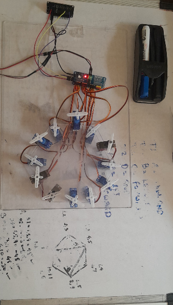
</p>

<p align="center">
  <em>Spider-Hex Mk I — prototype electronics and six-servo-leg mechanism.</em>
</p>

---

## The project

Spider-Hex is a six-legged quadruped-style robot platform exploring custom geared leg mechanisms and wireless movement control. The repository brings together ESP32 firmware, BLE clients, control notes, CAD renders, build photos, and progress videos.

| At a glance |  |
|:--|:--|
| **Locomotion** | Six legs with hip and knee servo channels |
| **Controller** | ESP32 running MicroPython |
| **Wireless link** | Bluetooth Low Energy using a Nordic UART-style service |
| **Servo driver** | PCA9685 over I²C |
| **Development status** | Experimental prototype; hardware behavior depends on the current firmware iteration |

## Build videos

Select a preview or its **Watch clip** link to open the MP4. The clips capture design, part fabrication, assembly, and bench work.

<table>
  <tr>
    <td width="50%" align="center">
      <a href="docs/videos/printed-gear-components.mp4">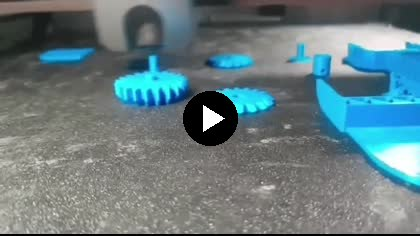</a><br>
      <strong>Printed gear components</strong><br><a href="docs/videos/printed-gear-components.mp4">▶ Watch clip · 3 sec</a>
    </td>
    <td width="50%" align="center">
      <a href="docs/videos/linkage-assembly.mp4">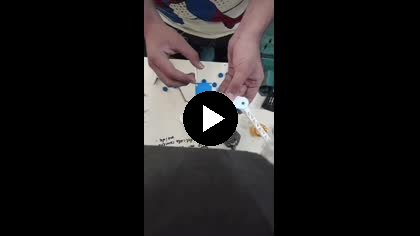</a><br>
      <strong>Leg linkage assembly</strong><br><a href="docs/videos/linkage-assembly.mp4">▶ Watch clip · 4 sec</a>
    </td>
  </tr>
  <tr>
    <td width="50%" align="center">
      <a href="docs/videos/workbench-prototype.mp4"></a><br>
      <strong>Prototype on the workbench</strong><br><a href="docs/videos/workbench-prototype.mp4">▶ Watch clip · 4 sec</a>
    </td>
    <td width="50%" align="center">
      <a href="docs/videos/cad-model-walkthrough.mp4">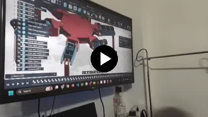</a><br>
      <strong>CAD model walkthrough</strong><br><a href="docs/videos/cad-model-walkthrough.mp4">▶ Watch clip · 4 sec</a>
    </td>
  </tr>
  <tr>
    <td width="50%" align="center">
      <a href="docs/videos/printed-parts-closeup.mp4">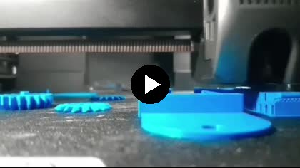</a><br>
      <strong>Printed parts close-up</strong><br><a href="docs/videos/printed-parts-closeup.mp4">▶ Watch clip · 3 sec</a>
    </td>
    <td width="50%" align="center">
      <a href="docs/videos/cad-design-review.mp4">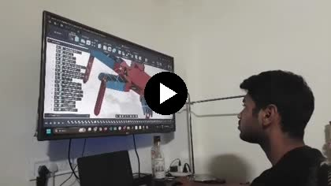</a><br>
      <strong>CAD design review</strong><br><a href="docs/videos/cad-design-review.mp4">▶ Watch clip · 4 sec</a>
    </td>
  </tr>
  <tr>
    <td width="50%" align="center">
      <a href="docs/videos/hardware-prototype-session.mp4"></a><br>
      <strong>Hardware prototype session</strong><br><a href="docs/videos/hardware-prototype-session.mp4">▶ Watch clip · 45 sec</a>
    </td>
    <td width="50%" align="center">
      <a href="docs/videos/electronics-assembly.mp4">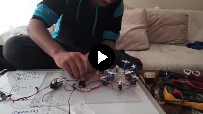</a><br>
      <strong>Electronics assembly</strong><br><a href="docs/videos/electronics-assembly.mp4">▶ Watch clip · 15 sec</a>
    </td>
  </tr>
</table>

## Design & build gallery

<table>
  <tr>
    <td width="50%" align="center">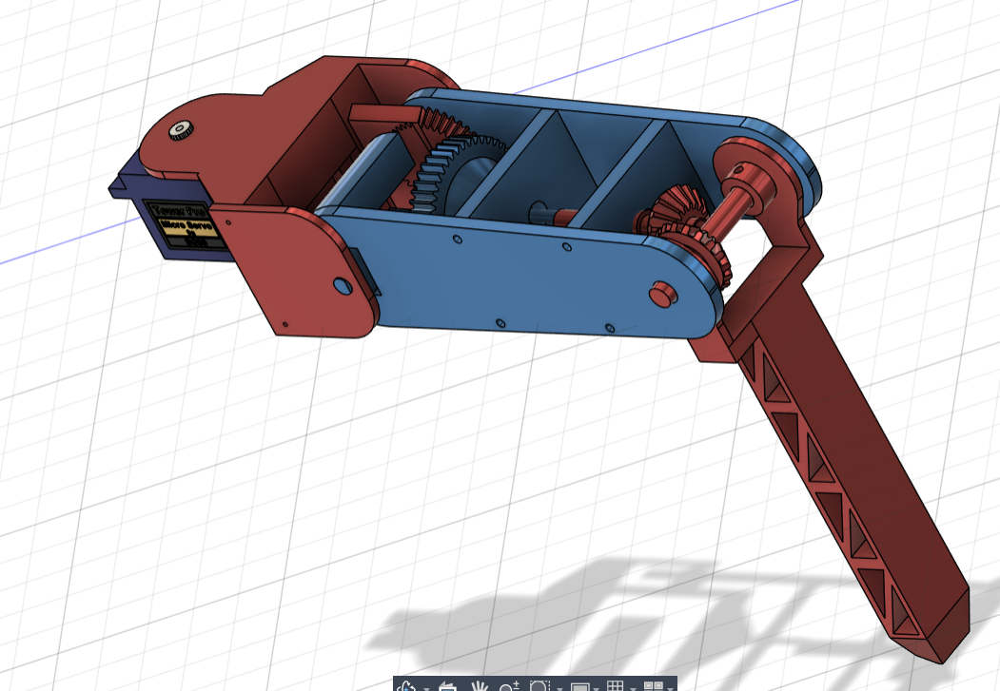<br><strong>Geared leg mechanism</strong></td>
    <td width="50%" align="center">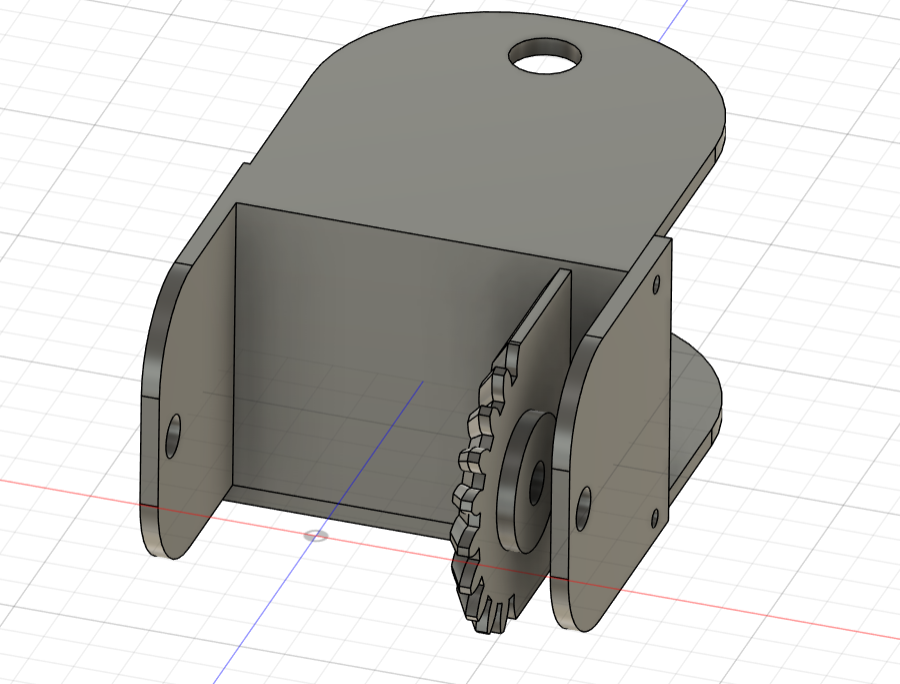<br><strong>Joint and gear layout</strong></td>
  </tr>
  <tr>
    <td width="50%" align="center"><br><strong>Electronics and servo assembly</strong></td>
    <td width="50%" align="center">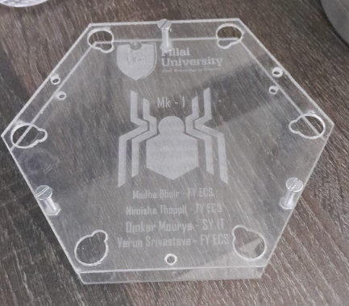<br><strong>Custom engraved top plate</strong></td>
  </tr>
</table>

## Control interface

The screenshots below show the Android BLE controller used during earlier prototype iterations. The Android app itself is not included in this repository.

<table>
  <tr>
    <td align="center">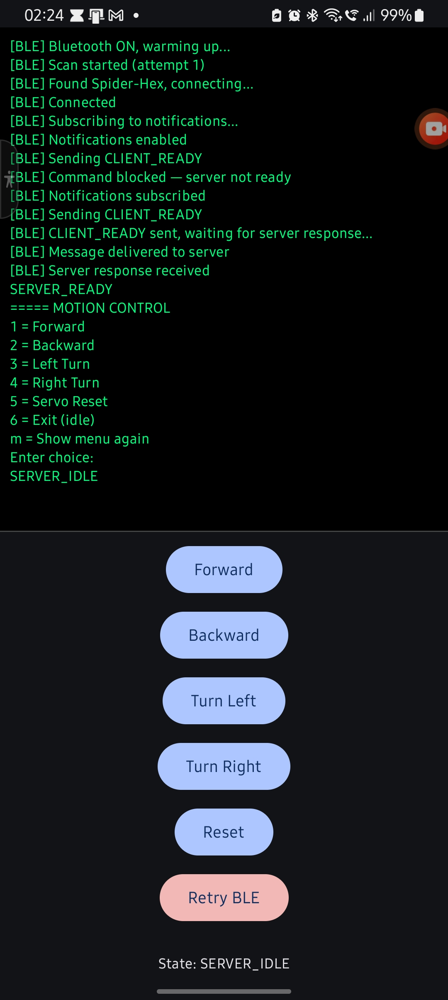<br><strong>Connected</strong></td>
    <td align="center">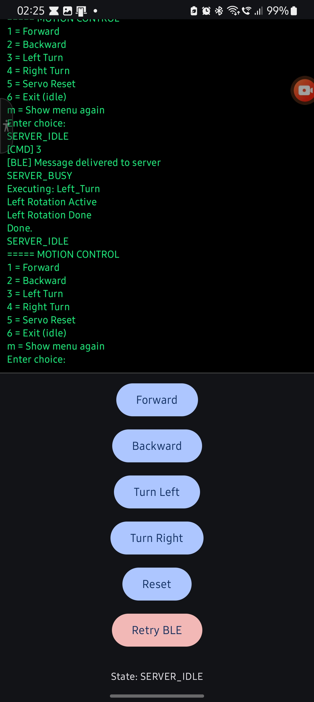<br><strong>Left turn</strong></td>
    <td align="center">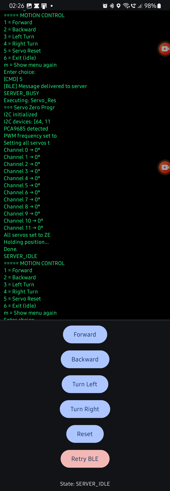<br><strong>Servo reset</strong></td>
  </tr>
</table>

## Firmware & control code

The repo contains multiple iterations. The current modular **V5** snapshot is experimental and is included as a development reference.

### Hardware assumptions in V5

| Component | V5 configuration |
|:--|:--|
| ESP32 | MicroPython |
| PCA9685 | I²C address `0x40`; SDA `21`, SCL `22` |
| Ultrasonic sensor | HC-SR04-style; TRIG `5`, ECHO `18` |
| BLE device name | `Spider-Hex` |
| Laptop client | Python with [`bleak`](https://github.com/hbldh/bleak) |

Pin assignments, servo angles, and wiring may need adjustment for the assembled robot.

### Run the laptop BLE client

Install `bleak`, then run:

```bash
python -m pip install bleak
python "BT/Laptop side/V5/ble_client_v5.py"
```

Copy the files under `BT/ESP32 side/V5/` to the ESP32 while preserving the `core/` and `motion/` folders, then start `main.py` with MicroPython.

### V5 command map

| Key | Command |
|:--:|:--|
| `1` | Forward |
| `2` | Backward |
| `3` | Turn left |
| `4` | Turn right |
| `5` | Reset servos |
| `6` | Stop *(not currently reliable)* |

> **Prototype limitation:** V5 runs its gait loop synchronously. While it is moving, it cannot process another BLE command or refresh the obstacle-distance reading. Treat V5 as a code reference only; do not rely on `STOP` or obstacle avoidance as safety controls.

## Repository map

| Path | Contents |
|:--|:--|
| `BT/ESP32 side/` | ESP32 BLE server and motion firmware, including the modular V5 prototype |
| `BT/Laptop side/` | Laptop BLE clients |
| `Control_Logic/` | Gait and control reference documents |
| `docs/images/` | Build photos, CAD renders, and controller screenshots |
| `docs/videos/` | Original MP4 progress clips and README preview thumbnails |

---

<p align="center"><sub>Spider-Hex Mk I · A work in progress, one leg at a time.</sub></p>
